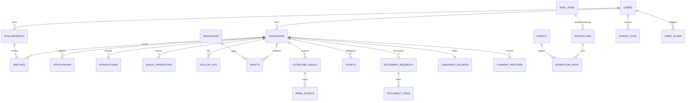

# Database schema

PostgreSQL in production (SQLite works for tests). Tables are created by SQLAlchemy (`app/models.py`); all timestamps are timezone-aware UTC.

## Entity overview

## `dq_snapshots`

| Column | Type | Notes |
|---|---|---|
| id | Integer | PK |
| snapshot_date | Date | indexed, not null |
| score | Float | not null |
| metrics | JSON | not null |
| created_at | TIMESTAMPTZ | not null |

## `email_templates`

| Column | Type | Notes |
|---|---|---|
| key | String | PK |
| name | String | not null |
| channel | String | not null |
| subject | String | not null |
| body | Text | not null |
| auto_send_allowed | Boolean | not null |
| description | Text | not null |
| updated_at | TIMESTAMPTZ | not null |

## `events`

| Column | Type | Notes |
|---|---|---|
| id | Integer | PK |
| type | String | indexed, not null |
| candidate_id | Integer | indexed |
| requirement_id | Integer |  |
| user_id | Integer |  |
| payload | JSON | not null |
| occurred_at | TIMESTAMPTZ | indexed, not null |

## `jobs`

| Column | Type | Notes |
|---|---|---|
| id | Integer | PK |
| type | String | not null |
| payload | JSON | not null |
| run_at | TIMESTAMPTZ | not null |
| status | String | not null |
| attempts | Integer | not null |
| max_attempts | Integer | not null |
| dedupe_key | String | indexed |
| last_error | Text |  |
| result | JSON | not null |
| workflow_id | Integer |  |
| created_at | TIMESTAMPTZ | not null |
| finished_at | TIMESTAMPTZ |  |

## `settings`

| Column | Type | Notes |
|---|---|---|
| key | String | PK |
| value | JSON |  |
| updated_at | TIMESTAMPTZ | not null |

## `users`

| Column | Type | Notes |
|---|---|---|
| id | Integer | PK |
| name | String | not null |
| email | String | indexed, unique, not null |
| role | String | indexed, not null |
| is_active | Boolean | not null |
| digest_enabled | Boolean | not null |
| digest_prefs | JSON | not null |
| created_at | TIMESTAMPTZ | not null |

## `audit_logs`

| Column | Type | Notes |
|---|---|---|
| id | Integer | PK |
| user_id | Integer | FK → users.id, indexed |
| action | String | indexed, not null |
| entity_type | String | not null |
| entity_id | String |  |
| detail | JSON | not null |
| ip | String |  |
| at | TIMESTAMPTZ | indexed, not null |

## `candidates`

| Column | Type | Notes |
|---|---|---|
| id | Integer | PK |
| full_name | String | not null |
| email | String | indexed |
| phone | String | indexed |
| linkedin_url | String | indexed |
| location | String | not null |
| source | String | not null |
| skills | JSON | not null |
| years_experience | Float |  |
| current_project_status | String | not null |
| work_authorization | String | not null |
| availability | String | not null |
| preferred_type | String | not null |
| expected_compensation | String | not null |
| work_arrangement | String | not null |
| stage | String | indexed, not null |
| last_contact_at | TIMESTAMPTZ |  |
| next_follow_up_at | TIMESTAMPTZ | indexed |
| owner_id | Integer | FK → users.id, indexed |
| past_projects | Text | not null |
| interview_status | String | not null |
| career_goals | Text | not null |
| headline | String | not null |
| summary | Text | not null |
| university | String | not null |
| degree | String | not null |
| grad_year | Integer |  |
| resume_text | Text | not null |
| linkedin_status | String | not null |
| hot_reply | Boolean | not null |
| hot_reply_at | TIMESTAMPTZ |  |
| last_reply_class | String |  |
| last_reply_at | TIMESTAMPTZ |  |
| email_opt_out | Boolean | not null |
| snoozed_until | TIMESTAMPTZ |  |
| fit_score | Float |  |
| qualification_decision | String |  |
| vendor_conflict | JSON | not null |
| comfort_check | JSON | not null |
| process_explained_at | TIMESTAMPTZ |  |
| w2_c2c_explained | Boolean | not null |
| retention_expires_at | TIMESTAMPTZ |  |
| merged_into_id | Integer | FK → candidates.id |
| purged | Boolean | not null |
| created_at | TIMESTAMPTZ | indexed, not null |
| updated_at | TIMESTAMPTZ | not null |

## `notifications`

| Column | Type | Notes |
|---|---|---|
| id | Integer | PK |
| user_id | Integer | FK → users.id, indexed, not null |
| title | String | not null |
| body | Text | not null |
| link | String |  |
| kind | String | not null |
| read | Boolean | not null |
| created_at | TIMESTAMPTZ | indexed, not null |

## `requirements`

| Column | Type | Notes |
|---|---|---|
| id | Integer | PK |
| title | String | not null |
| client | String | not null |
| skills | JSON | not null |
| location | String | not null |
| work_arrangement | String | not null |
| employment_type | String | not null |
| rate | String | not null |
| min_years | Integer | not null |
| priority | String | not null |
| status | String | indexed, not null |
| description | Text | not null |
| accepted_work_auth | JSON | not null |
| source | String | not null |
| owner_id | Integer | FK → users.id |
| created_at | TIMESTAMPTZ | indexed, not null |

## `task_items`

| Column | Type | Notes |
|---|---|---|
| id | String | PK |
| playbook_section | String | not null |
| stage | String | indexed, not null |
| task_name | Text | not null |
| frequency | String | not null |
| current_owner | String | not null |
| category | String | indexed, not null |
| rationale | Text | not null |
| trigger | Text | not null |
| automation_action | Text | not null |
| delegate_to | String |  |
| sla_hours | Integer |  |
| est_minutes_saved_per_week | Integer | not null |
| baseline_minutes_per_week | Integer | not null |
| status | String | not null |
| workflow_key | String |  |
| sort_order | Integer | not null |
| updated_at | TIMESTAMPTZ | not null |
| updated_by | Integer | FK → users.id |

## `applications`

| Column | Type | Notes |
|---|---|---|
| id | Integer | PK |
| candidate_id | Integer | FK → candidates.id, indexed, not null |
| requirement_id | Integer | FK → requirements.id |
| source | String | not null |
| fit_score | Float |  |
| shortlist_status | String | not null |
| raw | JSON | not null |
| created_at | TIMESTAMPTZ | indexed, not null |

## `call_list_items`

| Column | Type | Notes |
|---|---|---|
| id | Integer | PK |
| user_id | Integer | FK → users.id, indexed, not null |
| candidate_id | Integer | FK → candidates.id, not null |
| requirement_id | Integer | FK → requirements.id |
| list_date | Date | indexed, not null |
| rank | Integer | not null |
| score | Float | not null |
| reason | String | not null |
| status | String | not null |

## `candidate_folders`

| Column | Type | Notes |
|---|---|---|
| id | Integer | PK |
| candidate_id | Integer | FK → candidates.id, unique, not null |
| path | String | not null |
| subfolders | JSON | not null |
| acl | JSON | not null |
| created_at | TIMESTAMPTZ | not null |

## `compliance_flags`

| Column | Type | Notes |
|---|---|---|
| id | Integer | PK |
| candidate_id | Integer | FK → candidates.id, indexed |
| user_id | Integer | FK → users.id |
| source_type | String | not null |
| source_id | String |  |
| category | String | not null |
| matched_text | Text | not null |
| severity | String | not null |
| status | String | not null |
| reviewed_by | Integer | FK → users.id |
| created_at | TIMESTAMPTZ | indexed, not null |

## `consent_records`

| Column | Type | Notes |
|---|---|---|
| id | Integer | PK |
| candidate_id | Integer | FK → candidates.id, indexed, not null |
| consent_type | String | not null |
| token | String | unique, not null |
| status | String | not null |
| text_version | String | not null |
| consent_text | Text | not null |
| method | String | not null |
| ip | String |  |
| user_agent | String |  |
| requested_by | Integer | FK → users.id |
| requested_at | TIMESTAMPTZ | not null |
| recorded_at | TIMESTAMPTZ |  |
| revoked_at | TIMESTAMPTZ |  |

## `document_requests`

| Column | Type | Notes |
|---|---|---|
| id | Integer | PK |
| candidate_id | Integer | FK → candidates.id, indexed, not null |
| token | String | unique, not null |
| status | String | not null |
| reminders_sent | Integer | not null |
| last_reminder_at | TIMESTAMPTZ |  |
| escalated | Boolean | not null |
| expires_at | TIMESTAMPTZ | not null |
| created_at | TIMESTAMPTZ | not null |
| completed_at | TIMESTAMPTZ |  |

## `duplicate_pairs`

| Column | Type | Notes |
|---|---|---|
| id | Integer | PK |
| candidate_a_id | Integer | FK → candidates.id, not null |
| candidate_b_id | Integer | FK → candidates.id, not null |
| matched_on | JSON | not null |
| status | String | not null |
| created_at | TIMESTAMPTZ | not null |

## `follow_ups`

| Column | Type | Notes |
|---|---|---|
| id | Integer | PK |
| candidate_id | Integer | FK → candidates.id, indexed, not null |
| owner_id | Integer | FK → users.id, indexed |
| due_at | TIMESTAMPTZ | indexed, not null |
| reason | String | not null |
| status | String | indexed, not null |
| rule | String | not null |
| reminded_at | TIMESTAMPTZ |  |
| completed_at | TIMESTAMPTZ |  |
| created_at | TIMESTAMPTZ | not null |

## `habit_flags`

| Column | Type | Notes |
|---|---|---|
| id | Integer | PK |
| habit | String | indexed, not null |
| user_id | Integer | FK → users.id, indexed |
| candidate_id | Integer | FK → candidates.id |
| detail | Text | not null |
| dedupe_key | String | indexed, not null |
| status | String | not null |
| coaching_note | Text | not null |
| reviewed_by | Integer | FK → users.id |
| reviewed_at | TIMESTAMPTZ |  |
| created_at | TIMESTAMPTZ | indexed, not null |

## `interactions`

| Column | Type | Notes |
|---|---|---|
| id | Integer | PK |
| candidate_id | Integer | FK → candidates.id, indexed, not null |
| user_id | Integer | FK → users.id, indexed |
| type | String | indexed, not null |
| direction | String |  |
| subject | String | not null |
| body | Text | not null |
| outcome | String |  |
| meta | JSON | not null |
| meaningful | Boolean | not null |
| occurred_at | TIMESTAMPTZ | indexed, not null |

## `matches`

| Column | Type | Notes |
|---|---|---|
| id | Integer | PK |
| candidate_id | Integer | FK → candidates.id, indexed, not null |
| requirement_id | Integer | FK → requirements.id, indexed, not null |
| score | Float | not null |
| breakdown | JSON | not null |
| status | String | not null |
| is_reengagement | Boolean | not null |
| created_at | TIMESTAMPTZ | not null |

## `sequences`

| Column | Type | Notes |
|---|---|---|
| id | Integer | PK |
| candidate_id | Integer | FK → candidates.id, indexed, not null |
| requirement_id | Integer | FK → requirements.id |
| owner_id | Integer | FK → users.id |
| status | String | not null |
| current_step | Integer | not null |
| next_send_at | TIMESTAMPTZ | indexed |
| stop_reason | String |  |
| created_at | TIMESTAMPTZ | not null |

## `stage_transitions`

| Column | Type | Notes |
|---|---|---|
| id | Integer | PK |
| candidate_id | Integer | FK → candidates.id, indexed, not null |
| from_stage | String |  |
| to_stage | String | indexed, not null |
| reason | Text | not null |
| manual | Boolean | not null |
| trigger | String | not null |
| user_id | Integer | FK → users.id |
| at | TIMESTAMPTZ | indexed, not null |

## `tickets`

| Column | Type | Notes |
|---|---|---|
| id | Integer | PK |
| team | String | indexed, not null |
| kind | String | not null |
| subject | String | not null |
| description | Text | not null |
| candidate_id | Integer | FK → candidates.id, indexed |
| requested_by | Integer | FK → users.id |
| assignee_id | Integer | FK → users.id |
| status | String | indexed, not null |
| sla_hours | Integer | not null |
| due_at | TIMESTAMPTZ | not null |
| breached | Boolean | not null |
| breach_notified | Boolean | not null |
| resolution | Text | not null |
| candidate_acknowledged | Boolean | not null |
| created_at | TIMESTAMPTZ | not null |
| resolved_at | TIMESTAMPTZ |  |

## `workflows`

| Column | Type | Notes |
|---|---|---|
| id | Integer | PK |
| key | String | unique, not null |
| name | String | not null |
| description | Text | not null |
| task_id | String | FK → task_items.id |
| trigger_event | String | indexed, not null |
| schedule | String |  |
| conditions | JSON | not null |
| actions | JSON | not null |
| enabled | Boolean | not null |
| is_template | Boolean | not null |
| system | Boolean | not null |
| minutes_saved_per_run | Float | not null |
| run_count | Integer | not null |
| last_run_at | TIMESTAMPTZ |  |
| created_at | TIMESTAMPTZ | not null |

## `document_items`

| Column | Type | Notes |
|---|---|---|
| id | Integer | PK |
| request_id | Integer | FK → document_requests.id, indexed, not null |
| candidate_id | Integer | FK → candidates.id, indexed, not null |
| doc_type | String | not null |
| label | String | not null |
| folder | String | not null |
| required | Boolean | not null |
| needs_expiry | Boolean | not null |
| handled_by | String |  |
| status | String | not null |
| storage_key | String |  |
| filename | String |  |
| content_type | String |  |
| size_bytes | Integer |  |
| expiry_date | Date |  |
| validation | JSON | not null |
| uploaded_at | TIMESTAMPTZ |  |
| verified_by | Integer | FK → users.id |
| verified_at | TIMESTAMPTZ |  |
| review_note | Text | not null |

## `drafts`

| Column | Type | Notes |
|---|---|---|
| id | Integer | PK |
| candidate_id | Integer | FK → candidates.id, indexed |
| requirement_id | Integer | FK → requirements.id |
| owner_id | Integer | FK → users.id, indexed |
| kind | String | not null |
| channel | String | not null |
| subject | String | not null |
| body | Text | not null |
| status | String | indexed, not null |
| compliance | JSON | not null |
| sequence_id | Integer | FK → sequences.id |
| step | Integer |  |
| send_offset_days | Integer | not null |
| generated_by | String | not null |
| created_at | TIMESTAMPTZ | not null |
| approved_at | TIMESTAMPTZ |  |
| approved_by | Integer | FK → users.id |
| sent_at | TIMESTAMPTZ |  |

## `recruitment_posts`

| Column | Type | Notes |
|---|---|---|
| id | Integer | PK |
| title | String | not null |
| body | Text | not null |
| channel | String | not null |
| requirement_id | Integer | FK → requirements.id |
| status | String | not null |
| checklist | JSON | not null |
| ticket_id | Integer | FK → tickets.id |
| requested_by | Integer | FK → users.id |
| published_at | TIMESTAMPTZ |  |
| created_at | TIMESTAMPTZ | not null |

## `workflow_runs`

| Column | Type | Notes |
|---|---|---|
| id | Integer | PK |
| workflow_id | Integer | FK → workflows.id, indexed, not null |
| event_id | Integer | FK → events.id |
| candidate_id | Integer |  |
| status | String | not null |
| detail | JSON | not null |
| at | TIMESTAMPTZ | indexed, not null |

## `outbound_emails`

| Column | Type | Notes |
|---|---|---|
| id | String | PK |
| to_email | String | indexed, not null |
| subject | String | not null |
| html | Text | not null |
| text | Text | not null |
| kind | String | indexed, not null |
| candidate_id | Integer | FK → candidates.id, indexed |
| user_id | Integer | FK → users.id |
| draft_id | Integer | FK → drafts.id |
| status | String | not null |
| body_hash | String | indexed, not null |
| provider_message_id | String |  |
| error | Text |  |
| attachments | JSON | not null |
| created_at | TIMESTAMPTZ | indexed, not null |
| sent_at | TIMESTAMPTZ |  |
| opened_at | TIMESTAMPTZ |  |
| open_count | Integer | not null |
| click_count | Integer | not null |

## `digest_logs`

| Column | Type | Notes |
|---|---|---|
| id | Integer | PK |
| user_id | Integer | FK → users.id, indexed, not null |
| digest_date | Date | indexed, not null |
| kind | String | not null |
| status | String | not null |
| counts | JSON | not null |
| email_id | String | FK → outbound_emails.id |
| created_at | TIMESTAMPTZ | not null |

## `email_events`

| Column | Type | Notes |
|---|---|---|
| id | Integer | PK |
| email_id | String | FK → outbound_emails.id, indexed, not null |
| type | String | not null |
| url | Text |  |
| at | TIMESTAMPTZ | not null |
